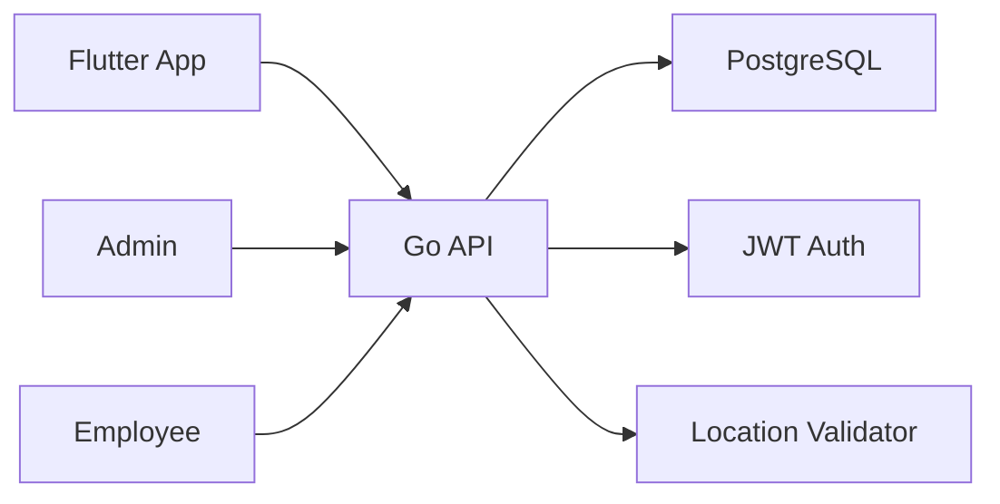
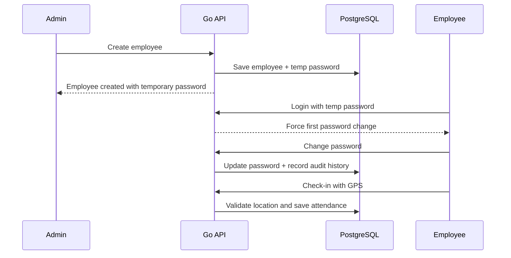

# Office Attendance Management API

This project is a Go-based backend API service for an employee attendance application used by office employees and admins.

## Overview

The application has two roles:

- Admin
- Employee

Admins can add employees, view attendance records, and generate reports. Employees can log in, change their first-time password, and mark attendance by submitting their GPS location.

## Updated business rules

1. Admin creates an employee with name, email, and phone number.
2. A unique employee ID is auto-generated.
3. Duplicate email and phone numbers are rejected.
4. A temporary login password is generated automatically when the employee is created.
5. The employee must change the password on first login.
6. The new password must follow this validation pattern:
   - minimum 7 characters
   - at least 1 uppercase letter
   - at least 1 number
   - at least 1 special character
7. After the first-time password change succeeds, the system records an audit entry saying that the first login password was changed.
8. Employee attendance is marked only when the device location falls within the approved office radius.

## Architecture



### Flow



## Database design

### Users

- id
- employee_id
- full_name
- email
- phone
- password_hash
- role
- is_first_login_required
- password_changed_at
- created_at
- updated_at

### Employees

- id
- user_id
- employee_id
- department
- designation
- office_latitude
- office_longitude
- allowed_radius_meters
- created_at
- updated_at

### Attendance

- id
- employee_id
- check_in_time
- check_out_time
- latitude
- longitude
- accuracy
- status
- created_at
- updated_at

### Password history

- id
- employee_id
- changed_by
- old_password_hash
- new_password_hash
- change_type
- changed_at
- created_at

## API endpoints

### Authentication

#### POST /api/v1/auth/login

Request body:

```json
{
  "employee_id": "EMP-001",
  "password": "TempPass@123"
}
```

#### POST /api/v1/auth/change-password

Request body:

```json
{
  "employee_id": "EMP-001",
  "old_password": "TempPass@123",
  "new_password": "Priya@2026",
  "confirm_password": "Priya@2026"
}
```

### Admin

#### POST /api/v1/admin/employees

Creates a new employee and generates a temporary password.

#### GET /api/v1/admin/attendance

Returns attendance records for admin view.

#### GET /api/v1/admin/reports/attendance

Returns report data for a date range.

### Employee

#### POST /api/v1/employee/attendance/checkin

Request:

```json
{
  "employee_id": "EMP-001",
  "latitude": 19.0760,
  "longitude": 72.8777,
  "accuracy": 25
}
```

## Admin employee management flow

This flow is fully implemented.

### 1. Login as admin

On Windows PowerShell, store the token in a shell variable:

```powershell
$BASE_URL = "http://localhost:8080"
$login = Invoke-RestMethod -Method Post -Uri "$BASE_URL/api/v1/auth/login" `
  -ContentType "application/json" `
  -Body '{"employee_id":"ADMIN-001","password":"Admin@123"}'
$TOKEN = $login.data.token
```

On macOS or Linux:

```bash
export BASE_URL="http://localhost:8080"
export ADMIN_LOGIN_RESPONSE="$(curl -s -X POST "$BASE_URL/api/v1/auth/login" \
  -H "Content-Type: application/json" \
  -d '{"employee_id":"ADMIN-001","password":"Admin@123"}')"
export TOKEN="$(printf '%s' "$ADMIN_LOGIN_RESPONSE" | python3 -c 'import json,sys; print(json.load(sys.stdin)["data"]["token"])')"
```

Windows curl example:

```powershell
$loginResponse = curl.exe -X POST "$BASE_URL/api/v1/auth/login" `
  -H "Content-Type: application/json" `
  -d '{"employee_id":"ADMIN-001","password":"Admin@123"}'
$loginResponse
```

The response includes the JWT and confirms the current admin role:

```json
{
  "success": true,
  "data": {
    "token": "<jwt>",
    "user": {
      "employee_id": "ADMIN-001",
      "role": "admin",
      "full_name": "System Admin"
    }
  }
}
```

### 2. List employees

```bash
curl -X GET "$BASE_URL/api/v1/admin/employees?page=1&page_size=20&search=engineering" \
  -H "Authorization: Bearer $TOKEN"
```

PowerShell:

```powershell
curl.exe -X GET "$BASE_URL/api/v1/admin/employees?page=1&page_size=20&search=engineering" `
  -H "Authorization: Bearer $TOKEN"
```

Example response:

```json
{
  "success": true,
  "data": {
    "items": [
      {
        "employee_id": "EMP-001",
        "full_name": "Test Employee",
        "email": "test.employee@example.com",
        "phone": "+15550000099",
        "department": "Engineering",
        "designation": "Developer",
        "role": "employee",
        "is_first_login_required": true,
        "password_changed_at": null,
        "created_at": "2026-10-24T12:00:00Z"
      }
    ],
    "total": 1,
    "page": 1,
    "page_size": 20
  }
}
```

### 3. Get employee details

```bash
curl -X GET "$BASE_URL/api/v1/admin/employees/EMP-001" \
  -H "Authorization: Bearer $TOKEN"
```

PowerShell:

```powershell
curl.exe -X GET "$BASE_URL/api/v1/admin/employees/EMP-001" `
  -H "Authorization: Bearer $TOKEN"
```

### 4. Edit employee details

Employee ID is immutable. The employee user and profile records are updated in one transaction.

```bash
curl -X PUT "$BASE_URL/api/v1/admin/employees/EMP-001" \
  -H "Authorization: Bearer $TOKEN" \
  -H "Content-Type: application/json" \
  -d '{
    "full_name": "Ananya Sharma",
    "email": "ananya.sharma@example.com",
    "phone": "+919876543210",
    "department": "Engineering",
    "designation": "Senior Developer"
  }'
```

PowerShell:

```powershell
curl.exe -X PUT "$BASE_URL/api/v1/admin/employees/EMP-001" `
  -H "Authorization: Bearer $TOKEN" `
  -H "Content-Type: application/json" `
  -d '{"full_name":"Ananya Sharma","email":"ananya.sharma@example.com","phone":"+919876543210","department":"Engineering","designation":"Senior Developer"}'
```

The success response contains the updated employee details.

### 5. Request employee password reset

This generates a new temporary password, invalidates the old password, sets `is_first_login_required=true`, and records an `admin_reset` audit entry.

```bash
curl -X POST "$BASE_URL/api/v1/admin/employees/EMP-001/password-reset" \
  -H "Authorization: Bearer $TOKEN"
```

PowerShell:

```powershell
curl.exe -X POST "$BASE_URL/api/v1/admin/employees/EMP-001/password-reset" `
  -H "Authorization: Bearer $TOKEN"
```

Example response:

```json
{
  "success": true,
  "data": {
    "employee_id": "EMP-001",
    "temporary_password": "Ab1@Cde2Xyz9",
    "require_password_change": true,
    "message": "Temporary password generated. The employee must change it on next login."
  }
}
```

The temporary password is returned once. Share it through a secure channel and do not store it in application logs.

### 6. Employee completes first-login reset

```bash
curl -X POST "$BASE_URL/api/v1/auth/change-password" \
  -H "Content-Type: application/json" \
  -d '{
    "employee_id": "EMP-001",
    "old_password": "Ab1@Cde2Xyz9",
    "new_password": "NewPass1!",
    "confirm_password": "NewPass1!"
  }'
```

The employee account is marked complete and password history records `change_type: "first_login"`.

## API testing with curl

Set the base URL before running these examples:

```bash
BASE_URL="http://localhost:8080"
```

### 1. Health check

```bash
curl -X GET "$BASE_URL/health"
```

### 2. Login

```bash
curl -X POST "$BASE_URL/api/v1/auth/login" \
  -H "Content-Type: application/json" \
  -d '{
    "employee_id": "EMP-001",
    "password": "TempPass@123"
  }'
```

### 3. Change password

```bash
curl -X POST "$BASE_URL/api/v1/auth/change-password" \
  -H "Content-Type: application/json" \
  -H "Authorization: Bearer <employee_or_admin_jwt>" \
  -d '{
    "employee_id": "EMP-001",
    "old_password": "TempPass@123",
    "new_password": "Priya@2026",
    "confirm_password": "Priya@2026"
  }'
```

### 4. Create employee (admin)

```bash
curl -X POST "$BASE_URL/api/v1/admin/employees" \
  -H "Content-Type: application/json" \
  -H "Authorization: Bearer <admin_jwt>" \
  -d '{
    "full_name": "Ananya Sharma",
    "email": "ananya.sharma@example.com",
    "phone": "+919876543210"
  }'
```

### 5. Get admin attendance

```bash
curl -X GET "$BASE_URL/api/v1/admin/attendance" \
  -H "Authorization: Bearer <admin_jwt>"
```

### 6. Get attendance report

```bash
curl -X GET "$BASE_URL/api/v1/admin/reports/attendance?start_date=2026-10-01&end_date=2026-10-10" \
  -H "Authorization: Bearer <admin_jwt>"
```

### 7. Employee check-in

```bash
curl -X POST "$BASE_URL/api/v1/employee/attendance/checkin" \
  -H "Content-Type: application/json" \
  -H "Authorization: Bearer <employee_jwt>" \
  -d '{
    "employee_id": "EMP-001",
    "latitude": 19.0760,
    "longitude": 72.8777,
    "accuracy": 25
  }'
```

Example response for valid location check-in:

```json
{
  "message": "Attendance marked successfully",
  "status": "checked_in"
}
```

## Local installation and run

### Prerequisites

- Git
- Go 1.25 or later
- PostgreSQL 15 or later
- macOS: Homebrew is optional but recommended
- Windows: PostgreSQL installer and PowerShell 5.1+

### macOS installation

```bash
brew install git go postgresql@18
brew services start postgresql@18
export PATH="$(brew --prefix postgresql@18)/bin:$PATH"
```

Create the database and set a local password:

```bash
createuser -s postgres || true
psql postgres -c "ALTER USER postgres PASSWORD '57hesoyam';"
createdb -U postgres attendance_db
```

Clone and configure:

```bash
git clone <repo-url>
cd Attendance_Backend
cp .env.example .env
go mod tidy
go run ./cmd/server
```

### Windows installation

Install Git and Go:

```powershell
winget install --id Git.Git --exact
winget install --id GoLang.Go --exact
winget install --id PostgreSQL.PostgreSQL.18 --exact
```

Open a new terminal so `go`, `git`, and PostgreSQL commands are available. Create the database using SQL shell or PowerShell:

```powershell
& 'C:\Program Files\PostgreSQL\18\bin\psql.exe' -U postgres -d postgres
```

Inside `psql`:

```sql
ALTER USER postgres PASSWORD '57hesoyam';
CREATE DATABASE attendance_db;
\q
```

Clone and configure:

```powershell
git clone <repo-url>
cd Attendance_Backend
Copy-Item .env.example .env
go mod tidy
go run ./cmd/server
```

### Environment file

Use this as the local baseline:

```env
APP_PORT=8080
APP_ENV=development
DB_HOST=localhost
DB_PORT=5432
DB_NAME=attendance_db
DB_USER=postgres
DB_PASSWORD=57hesoyam
JWT_SECRET=change-this-super-secret-key
OFFICE_LATITUDE=19.0760
OFFICE_LONGITUDE=72.8777
ALLOWED_RADIUS_METERS=100
```

Do not commit a real production JWT secret or database password.

### Validate local startup

Terminal output should contain:

```text
Database migrations completed successfully.
Attendance API running on http://localhost:8080
Listening and serving HTTP on :8080
```

The server must keep running in this terminal.

### Swagger

Open:

```text
http://localhost:8080/swagger/index.html
```

The machine-readable specification is available at:

```text
http://localhost:8080/swagger/doc.json
```

### Build and test

```bash
go fmt ./...
go test ./...
go build ./...
```

Windows and macOS use the same commands.

### 6. Health check

```bash
http://localhost:8080/health
```

Expected response:

```json
{
  "status": "ok"
}
```

### Optional: build the app with Dockerfile

If you want to build the service as a container image instead of using `go run`, this project also includes a Dockerfile.

```bash
docker build -t attendance-backend .
docker run --env-file .env -p 8080:8080 attendance-backend
```

> The database itself should still be installed locally on your machine and reachable at `localhost:5432`.

Expected response:

```json
{
  "status": "ok"
}
```

## Password policy

The employee password must satisfy all of the following:

- at least 7 characters
- at least 1 uppercase letter
- at least 1 number
- at least 1 special character

Example valid passwords:

- Abc@123
- Priya@2026
- Mark!9xyz

## Implementation status

| Area | Status |
|---|---|
| Health endpoint | Complete |
| Admin and employee login | Complete |
| First-login password change and audit | Complete |
| Create employee | Complete |
| Employee list and search | Complete |
| Employee detail | Complete |
| Employee edit | Complete |
| Admin password reset request | Complete |
| JWT authorization for admin employee routes | Complete |
| CORS for local UI | Complete |
| Swagger | Complete |
| `GET /api/v1/auth/me` | Pending |
| Attendance check-in/check-out | Pending |
| Admin attendance dashboard API | Pending |
| Attendance reports | Pending |

See [IMPLEMENTATION_STATUS.md](IMPLEMENTATION_STATUS.md) for detailed flow ownership and pending work.

## Security notes

- Passwords are hashed before storing.
- Temporary passwords are returned once and should be delivered through a secure channel.
- Admin employee administration endpoints require a JWT with `role=admin`.
- First-login password changes are required for newly created or reset employees.
- Attendance check-ins must pass location validation before being saved.

## Recommended next steps

- Add real admin authentication middleware.
- Add structured employee email/SMS sending for temp passwords.
- Add report filters by date range and department.
- Add unit tests for password validation and attendance rules.
