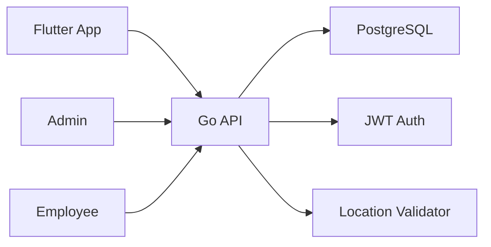
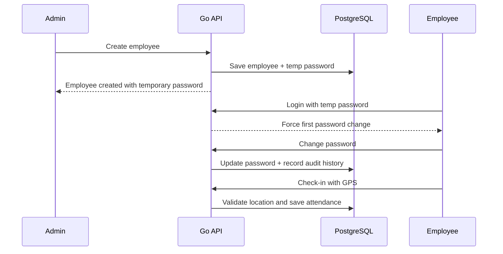

# Office Attendance Management API

This project is a Go-based backend API service for an employee attendance application used by office employees and admins.

## Overview

The application has two roles:

- Admin
- Employee

Admins can add employees, view attendance records, and generate reports. Employees can log in, change their first-time password, and mark attendance by submitting their GPS location.

## Updated business rules

1. Admin creates an employee with name, email, and phone number.
2. A unique employee ID is auto-generated.
3. Duplicate email and phone numbers are rejected.
4. A temporary login password is generated automatically when the employee is created.
5. The employee must change the password on first login.
6. The new password must follow this validation pattern:
   - minimum 7 characters
   - at least 1 uppercase letter
   - at least 1 number
   - at least 1 special character
7. After the first-time password change succeeds, the system records an audit entry saying that the first login password was changed.
8. Employee attendance is marked only when the device location falls within the approved office radius.

## Architecture



### Flow



## Database design

### Users

- id
- employee_id
- full_name
- email
- phone
- password_hash
- role
- is_first_login_required
- password_changed_at
- created_at
- updated_at

### Employees

- id
- user_id
- employee_id
- department
- designation
- office_latitude
- office_longitude
- allowed_radius_meters
- created_at
- updated_at

### Attendance

- id
- employee_id
- check_in_time
- check_out_time
- latitude
- longitude
- accuracy
- status
- created_at
- updated_at

### Password history

- id
- employee_id
- changed_by
- old_password_hash
- new_password_hash
- change_type
- changed_at
- created_at

## API endpoints

### Authentication

#### POST /api/v1/auth/login

Request body:

```json
{
  "employee_id": "EMP-001",
  "password": "TempPass@123"
}
```

#### POST /api/v1/auth/change-password

Request body:

```json
{
  "employee_id": "EMP-001",
  "old_password": "TempPass@123",
  "new_password": "Priya@2026",
  "confirm_password": "Priya@2026"
}
```

### Admin

#### POST /api/v1/admin/employees

Creates a new employee and generates a temporary password.

#### GET /api/v1/admin/attendance

Returns attendance records for admin view.

#### GET /api/v1/admin/reports/attendance

Returns report data for a date range.

### Employee

#### POST /api/v1/employee/attendance/checkin

Request:

```json
{
  "employee_id": "EMP-001",
  "latitude": 19.0760,
  "longitude": 72.8777,
  "accuracy": 25
}
```

## API testing with curl

Set the base URL before running these examples:

```bash
BASE_URL="http://localhost:8080"
```

### 1. Health check

```bash
curl -X GET "$BASE_URL/health"
```

### 2. Login

```bash
curl -X POST "$BASE_URL/api/v1/auth/login" \
  -H "Content-Type: application/json" \
  -d '{
    "employee_id": "EMP-001",
    "password": "TempPass@123"
  }'
```

### 3. Change password

```bash
curl -X POST "$BASE_URL/api/v1/auth/change-password" \
  -H "Content-Type: application/json" \
  -H "Authorization: Bearer <employee_or_admin_jwt>" \
  -d '{
    "employee_id": "EMP-001",
    "old_password": "TempPass@123",
    "new_password": "Priya@2026",
    "confirm_password": "Priya@2026"
  }'
```

### 4. Create employee (admin)

```bash
curl -X POST "$BASE_URL/api/v1/admin/employees" \
  -H "Content-Type: application/json" \
  -H "Authorization: Bearer <admin_jwt>" \
  -d '{
    "full_name": "Ananya Sharma",
    "email": "ananya.sharma@example.com",
    "phone": "+919876543210"
  }'
```

### 5. Get admin attendance

```bash
curl -X GET "$BASE_URL/api/v1/admin/attendance" \
  -H "Authorization: Bearer <admin_jwt>"
```

### 6. Get attendance report

```bash
curl -X GET "$BASE_URL/api/v1/admin/reports/attendance?start_date=2026-10-01&end_date=2026-10-10" \
  -H "Authorization: Bearer <admin_jwt>"
```

### 7. Employee check-in

```bash
curl -X POST "$BASE_URL/api/v1/employee/attendance/checkin" \
  -H "Content-Type: application/json" \
  -H "Authorization: Bearer <employee_jwt>" \
  -d '{
    "employee_id": "EMP-001",
    "latitude": 19.0760,
    "longitude": 72.8777,
    "accuracy": 25
  }'
```

Example response for valid location check-in:

```json
{
  "message": "Attendance marked successfully",
  "status": "checked_in"
}
```

## Local setup

### Prerequisites

- Go 1.22+
- PostgreSQL 15+ installed locally on your PC
- Git
- Optional: Docker only if you want to build the app as a container image

### 1. Clone the repo

```bash
git clone <repo-url>
cd Attendance_Backend
```

### 2. Install PostgreSQL locally

Install PostgreSQL on your machine and create a database named `attendance_db`.

Example on Windows using psql:

```sql
CREATE DATABASE attendance_db;
```

If needed, also create a PostgreSQL user with the same credentials used in the `.env` file.

### 3. Configure environment variables

Copy the template file and update values if needed:

```bash
copy .env.example .env
```

Required values in `.env`:

```env
APP_PORT=8080
APP_ENV=development
DB_HOST=localhost
DB_PORT=5432
DB_NAME=attendance_db
DB_USER=postgres
DB_PASSWORD=postgres
JWT_SECRET=change-this-super-secret-key
OFFICE_LATITUDE=19.0760
OFFICE_LONGITUDE=72.8777
ALLOWED_RADIUS_METERS=100
```

This project uses the local PostgreSQL instance, not Docker Compose.

### 4. Install Go dependencies

```bash
set PATH=%PATH%;C:\Program Files\Go\bin
go mod tidy
```

### 5. Run the API server

```bash
set PATH=%PATH%;C:\Program Files\Go\bin
go run ./cmd/server
```

### 6. Health check

```bash
http://localhost:8080/health
```

Expected response:

```json
{
  "status": "ok"
}
```

### Optional: build the app with Dockerfile

If you want to build the service as a container image instead of using `go run`, this project also includes a Dockerfile.

```bash
docker build -t attendance-backend .
docker run --env-file .env -p 8080:8080 attendance-backend
```

> The database itself should still be installed locally on your machine and reachable at `localhost:5432`.

Expected response:

```json
{
  "status": "ok"
}
```

## Password policy

The employee password must satisfy all of the following:

- at least 7 characters
- at least 1 uppercase letter
- at least 1 number
- at least 1 special character

Example valid passwords:

- Abc@123
- Priya@2026
- Mark!9xyz

## Security notes

- Passwords are hashed before storing.
- First-login password changes are required for newly created employees.
- JWT is used for authentication.
- Attendance check-ins must pass location validation before being saved.

## Recommended next steps

- Add real admin authentication middleware.
- Add structured employee email/SMS sending for temp passwords.
- Add report filters by date range and department.
- Add unit tests for password validation and attendance rules.
